### Два проекта. Один интерес — создавать своё.

## Пульс профиля

## Город активности

## Немного аркады

<picture>
  <source media="(prefers-color-scheme: dark)" srcset="https://raw.githubusercontent.com/120spartacus120-hash/120spartacus120-hash/output/pacman-contribution-graph-dark.svg" />
  <source media="(prefers-color-scheme: light)" srcset="https://raw.githubusercontent.com/120spartacus120-hash/120spartacus120-hash/output/pacman-contribution-graph.svg" />
  
</picture>

От идеи — к работающему приложению.

